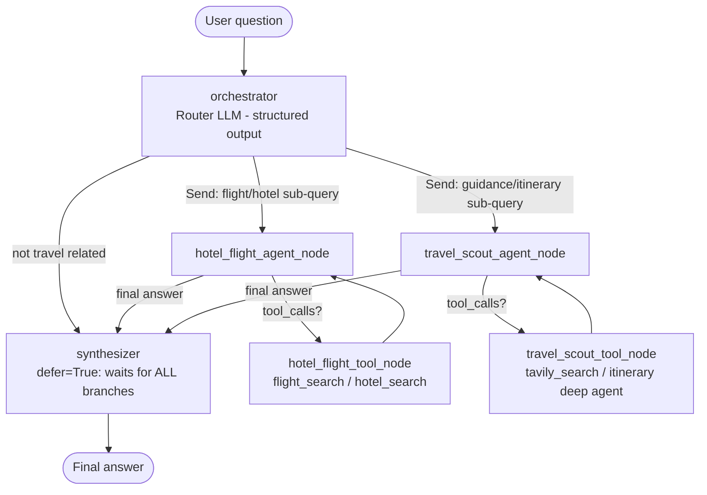

# ✈️ Multi Travel Agent

An **AI travel planner built as a multi-agent system** with **LangGraph**, **LangChain**, **Deep Agents** and a **Streamlit** chat UI.

You ask a travel question in plain English. A **router** decides which specialist agent(s) should handle it, runs them **in parallel**, and a **synthesizer** merges their answers into one clear response.

> This is a refactored, modular version of `../multi_travel_agent.py` (the original single-file notebook-style script, kept untouched for reference).

---

## 📑 Table of contents

1. [What it can do](#-what-it-can-do)
2. [How it works (architecture)](#-how-it-works-architecture)
3. [Project structure](#-project-structure)
4. [Setup](#-setup)
5. [How to use it](#-how-to-use-it)
6. [Example questions](#-example-questions)
7. [Key concepts explained](#-key-concepts-explained)
8. [How to extend it](#-how-to-extend-it)
9. [Limitations](#-limitations)
10. [Troubleshooting](#-troubleshooting)

---

## 🎯 What it can do

| Capability | Handled by | Data source |
|---|---|---|
| Search **flights** (one-way / round-trip, adults, children, stops) | Flight & Hotel agent | SerpAPI → Google Flights |
| Search **hotels** (location, check-in/out, guests) | Flight & Hotel agent | SerpAPI → Google Hotels |
| **Day-by-day itineraries** (timings, places, transport, costs, tips) | Travel Scout → Itinerary Deep Agent | Tavily web search |
| **General travel guidance**: best time to visit, weather, visas, safety, culture, packing, currency | Travel Scout agent | Tavily web search |
| **Combined requests** like *"Plan 3 days in Paris AND find hotels"* | Both agents **in parallel** + Synthesizer | All of the above |
| Politely **declines non-travel** questions (math, coding, etc.) | Router / Synthesizer | — |

Extra behaviour:
- Converts city names to airport codes (e.g. *Delhi → DEL*).
- Asks a **clarifying question** when required info is missing (e.g. no travel date for flights).
- Travel Scout answers include a **Sources** section.

---

## 🧠 How it works (architecture)

### High-level flow



### Step by step

1. **`orchestrator`**: an LLM with *structured output* (`ClassificationResult`) reads the question and returns a list of **tasks**. Each task has:
   - `source`: which agent (`flight_hotel_search_agent_node` or `travel_scout_agent_node`)
   - `user_query`: a focused sub-question for that agent
   - `focus`: what the agent should prioritise
2. **`dispatch_to_agents`**: uses LangGraph's `Send` API to **fan out**. Each task becomes its own parallel branch.
3. **Agent ⇄ Tool loop (ReAct)**: each agent is two nodes:
   - `*_agent_node`: the LLM either answers or asks for tool calls
   - `*_tool_node`: executes the tools and sends the results back to the agent
   - `should_continue_*` decides: *more tools?* → loop, *done?* → synthesizer
   - A safety limit (`MAX_TOOL_ROUNDS = 5`) prevents infinite loops.
4. **`synthesizer`** (`defer=True`): waits until **every** branch has finished, then:
   - 0 results → polite "travel questions only" message
   - 1 result → returned as is
   - 2+ results → merged by an LLM into one structured answer

### The agents

| Agent | Role | Tools |
|---|---|---|
| **Router** (`orchestrator`) | Splits the request into tasks, never answers itself | — |
| **Flight & Hotel agent** | Finds and compares flights/hotels, builds bundles (Value / Balanced / Comfort) | `flight_search`, `hotel_search` |
| **Travel Scout agent** | High-level guidance; delegates detailed itineraries | `tavily_search`, `call_itinerary_research_agent` |
| **Itinerary Deep Agent** | Researches and writes a full day-by-day plan | `tavily_search` |
| **Synthesizer** | Merges multiple agent outputs | — |

---

## 📁 Project structure

```text
Multi_Agent_Systems/
├── multi_travel_agent.py          # original single-file version (reference only)
└── Multi_Travel_Agent/            # ← this project
    ├── .env                       # API keys (placeholders - fill these in)
    ├── .gitignore                 # keeps .env, venv, __pycache__ out of git
    ├── README.md                  # you are here
    ├── requirements.txt           # Python dependencies
    ├── app.py                     # Streamlit chat UI
    └── travel_planner/            # the Python package (all agent logic)
        ├── __init__.py            # exposes build_graph()
        ├── config.py              # loads .env, creates the shared LLM
        ├── prompts.py             # ALL system prompts in one place
        ├── tools.py               # flight_search, hotel_search, tavily_search, itinerary deep agent
        ├── agents.py              # (optional) create_agent-based router version
        ├── state.py               # Pydantic models + LangGraph state
        ├── nodes.py               # orchestrator, agent/tool nodes, synthesizer
        └── graph.py               # wires nodes & edges → build_graph()
```

### What each file does

| File | Responsibility | Key objects |
|---|---|---|
| `config.py` | Reads API keys (shell env → `Multi_Travel_Agent/.env` → course-root `.env`, placeholders ignored), creates the LLM | `llm`, `missing_keys()`, `MODEL_NAME` |
| `prompts.py` | Every system prompt, so you can tune behaviour without touching logic | `HOTEL_FLIGHT_SEARCH_PROMPT`, `TRAVEL_SCOUT_PROMPT`, `ITINERARY_RESEARCH_PROMPT`, `ROUTER_PROMPT`, `MAIN_AGENT_PROMPT`, `SYNTHESIS_PROMPT` |
| `tools.py` | External API tools + the itinerary Deep Agent wrapped as a tool | `flight_search`, `hotel_search`, `tavily_search`, `call_itinerary_research_agent`, `hotel_flight_tools`, `travel_scout_tools` |
| `state.py` | Shape of the data that flows through the graph | `AgentTask`, `ClassificationResult`, `TravelPlannerState` |
| `nodes.py` | The functions that run at each graph step | `orchestrator`, `dispatch_to_agents`, `*_agent_node`, `*_tool_node`, `synthesizer_node` |
| `graph.py` | Connects nodes with edges and compiles the graph | `build_graph()` |
| `agents.py` | **Alternative** simpler design: sub-agents called *as tools* by a `main_agent` (sequential, not used by the UI) | `main_agent`, `hotel_flight_search_agent`, `travel_scout_agent` |
| `app.py` | Chat UI: shows API-key status, live agent steps, final answer | — |

**Dependency direction** (no circular imports):
`config → prompts → tools → state → nodes → graph → app.py`

---

## ⚙️ Setup

### 1. Prerequisites
- Python **3.10+**
- API keys:

| Key | Used for | Get it from | Free tier |
|---|---|---|---|
| `OPENAI_API_KEY` | The LLM behind every agent (**required**) | https://platform.openai.com/api-keys | Paid (pay-as-you-go) |
| `TAVILY_API_KEY` | Web research (guidance + itineraries) | https://app.tavily.com | Yes |
| `SERPAPI_API_KEY` | Google Flights & Google Hotels | https://serpapi.com/manage-api-key | Yes (limited searches/month) |

### 2. Install dependencies

```bash
cd "Multi_Agent_Systems/Multi_Travel_Agent"

# (recommended) create a virtual environment
python3 -m venv venv
source venv/bin/activate          # Windows: venv\Scripts\activate

pip install -r requirements.txt
```

### 3. Add your API keys

Open `.env` and replace the placeholders:

```env
OPENAI_API_KEY=sk-...
TAVILY_API_KEY=tvly-...
SERPAPI_API_KEY=...
```

> Values starting with `your_` are treated as **not set**. If a key isn't in this `.env`, `config.py` also checks the course-root `.env` (`Agentic AI basics Notes/.env`).
> `.env` is git-ignored, so **never commit real keys**.

---

## 🚀 How to use it

> Always run commands **from inside the `Multi_Travel_Agent/` folder** so Python can find the `travel_planner` package.

### Option A: Streamlit chat UI (recommended)

```bash
streamlit run app.py
```

Your browser opens at http://localhost:8501. In the UI:
- **Sidebar**: API-key status (✅ / ❌), toggle for *Show agent steps*, example buttons, *Clear chat*.
- **Agent steps panel**: shows live which node is running, plus the sub-queries the router created.
- **Chat**: final answer in Markdown.

### Option B: Command line

```bash
python -m travel_planner.graph "Plan 2 days in Agra for a history lover"
```

Prints each node as it runs, then the final answer.
Use `python -m ...`, not `python travel_planner/graph.py`; the package uses relative imports (`from .nodes import ...`).

### Option C: In your own Python code / notebook

```python
from travel_planner import build_graph

graph = build_graph()
result = graph.invoke(
    {"user_query": "Best time to visit Jodhpur?"},
    config={"configurable": {"thread_id": "demo-1"}},
)
print(result["final_answer"])
```

### Option D: The simpler `create_agent` version

```python
from travel_planner.agents import main_agent

out = main_agent.invoke({"messages": [{"role": "user", "content": "Best time to visit Jodhpur?"}]})
print(out["messages"][-1].content)
```

---

## 💬 Example questions

| Type | Example | Agents used |
|---|---|---|
| General guidance | *Best time to visit Jodhpur?* | Travel Scout → Tavily |
| Itinerary | *Plan 2 days in Agra for a history & culture lover* | Travel Scout → Itinerary Deep Agent |
| Flights | *Flights from Delhi to London on 2026-12-10 for 2 adults* | Flight & Hotel → Google Flights |
| Hotels | *Hotels in Goa from 2026-12-20 to 2026-12-23 for 2 adults* | Flight & Hotel → Google Hotels |
| Combined | *Plan 3 days in Paris and find hotels from 2026-12-10 to 2026-12-13 for 2 adults* | **Both in parallel** → Synthesizer |
| Off-topic | *What is 2 + 2?* | Router returns no tasks → polite decline |

**Tip:** give exact dates (`YYYY-MM-DD`), number of travellers and cities. Missing details make the agent ask a follow-up question instead of searching.

---

## 📚 Key concepts explained

| Concept | Where | What it means here |
|---|---|---|
| **StateGraph** | `graph.py` | A graph of Python functions (nodes) that share one state dict. |
| **State + reducers** | `state.py` | `Annotated[List, operator.add]` means *append*, not *overwrite*, so parallel branches can all write `agent_results` safely. |
| **Structured output** | `nodes.orchestrator` | `llm.with_structured_output(ClassificationResult)` forces the router LLM to return valid Pydantic objects instead of free text. |
| **`Send` (map / fan-out)** | `nodes.dispatch_to_agents` | Starts one branch per task, each with its **own** input (`user_query`, `focus`). Branches run in parallel. |
| **ReAct loop** | `*_agent_node` ⇄ `*_tool_node` | Reason → Act (tool) → Observe (result) → repeat until the LLM answers. |
| **Conditional edges** | `should_continue_*` | Pick the next node at runtime: tools again, or synthesizer. |
| **`defer=True`** | `graph.py` synthesizer | The node waits until all other pending branches finish, so it runs **once** with all results. |
| **Deep Agent** | `tools.call_itinerary_research_agent` | A planning-capable agent (`deepagents`) used *as a tool* by the Travel Scout. |
| **Checkpointer** | `MemorySaver` | Stores graph state per `thread_id` (in memory). |

---

## 🔧 How to extend it

**Add a new tool** (e.g. a currency converter):
1. Write a `@tool` function in `tools.py` (with a docstring, which the LLM reads).
2. Add it to `travel_scout_tools` (or `hotel_flight_tools`).

**Add a new agent** (e.g. a *Visa agent*):
1. Add its prompt in `prompts.py`.
2. Add its tools in `tools.py`.
3. In `nodes.py`, create `visa_agent_node`, `visa_tool_node`, `should_continue_visa` (copy the travel-scout trio, which uses the shared `_agent_step` / `_tool_step` / `_route` helpers), and add a `visa_messages` list to `TravelPlannerState`.
4. Add the new name to `AgentSource` in `state.py` and to `_NODE_FOR_SOURCE` in `nodes.py`.
5. Register the nodes and edges in `graph.py`.
6. Describe the new agent in `ROUTER_PROMPT`.

**Change the model:** set `TRAVEL_MODEL=gpt-4o` in `.env`.

**See every step in LangSmith:** uncomment the `LANGSMITH_*` lines in `.env`.

---

## ⚠️ Limitations

- **No real booking.** It only searches and recommends; it cannot book or pay.
- **One question at a time (no follow-up memory).** Each question runs on a fresh `thread_id`, so the agents don't remember earlier messages. If an agent asks a clarifying question, re-ask with **all** the details in one message.
- **Live data depends on third-party APIs.** Prices and availability come from SerpAPI (Google Flights/Hotels) and can be stale, incomplete or region-dependent. Free SerpAPI/Tavily tiers have monthly limits.
- **Prices are in USD** (hard-coded in `tools.py`).
- **Airport codes are inferred by the LLM.** Ambiguous cities (London, New York, Tokyo) may trigger a clarification or the wrong airport.
- **LLM output can be wrong.** Itineraries, opening hours, visa rules and costs may be outdated or hallucinated. Always verify with the official sources listed.
- **Latency and cost.** A combined request can make 5–15 LLM calls plus several API calls (often 20–90 s). Deep-agent itineraries are the slowest part.
- **Routing isn't perfect.** The router is an LLM, so it may occasionally send a request to the wrong agent or split it imperfectly.
- **In-memory only.** `MemorySaver` loses state when the app restarts; there is no database, user accounts or authentication.
- **Single-user dev setup.** Not hardened for production (no rate limiting, retries, caching or input sanitisation).

---

## 🩺 Troubleshooting

| Problem | Fix |
|---|---|
| `ModuleNotFoundError: No module named 'travel_planner'` | Run commands from **inside** `Multi_Travel_Agent/`. |
| `ImportError: attempted relative import with no known parent package` | Use `python -m travel_planner.graph`, not `python travel_planner/graph.py`. |
| `No module named 'serpapi'` | `pip install google-search-results` (the package name differs from the import name). |
| Sidebar shows ❌ for a key | Put the real value in `.env` (not `your_..._here`) and restart Streamlit. |
| Flights/hotels return *"Invalid API key"* or *"No results"* | Check `SERPAPI_API_KEY` and quota; use future dates in `YYYY-MM-DD`; use valid IATA codes. |
| Answer is just a question back to you | The agent needs more details (dates, cities, travellers). Re-ask with everything in one message. |
| Very slow responses | Expected for itineraries (Deep Agent + web research). Turn on *Show agent steps* to watch progress. |
