# AxiomCart Assistant: Multi-Agent Shopping Helper with Voice Support

AxiomCart Assistant is a command-line customer helper for an online store. It runs on a [LangGraph](https://langchain-ai.github.io/langgraph/) `StateGraph`. A routing step reads each customer message and passes it to one or two specialist agents: one for **product discovery** and one for **sales support**. If both agents answer, a final step merges their replies into one. You can type to it, or talk to it through a microphone and hear its answers spoken back.

---

## Overview

### Why use more than one agent?

Customers ask about different things. One message might be about the catalog (_"Show me noise-cancelling headphones"_), another about an order (_"What's happening with ORD103?"_), and some mix both (_"My Bose order is late, are there other headphones in stock?"_). AxiomCart handles this by giving each kind of question to its own agent, with its own instructions and tools, and then merging the replies when needed.

### The pipeline

```
START → orchestrator ─┬─ product_agent ──→ synthesizer → END
                      └─ support_agent ──↗
```

<p align="center">
  
</p>

| Node | Role |
|---|---|
| `orchestrator` | Sends the query to `gpt-4o` with structured output (`ClassificationResult`). Gets back a list of tasks and a `requires_synthesis` flag, then dispatches each task with `Send()`. |
| `product_agent` | Runs the **Product Discovery Agent** subgraph. It searches the catalog and also handles greetings, thanks, and small talk. |
| `support_agent` | Runs the **Sales Support Agent** subgraph. It looks up orders, opens escalation tickets, and pauses to ask the customer when an order ID or email is missing. |
| `synthesizer` | Returns a single agent's reply as-is, or asks the LLM to merge several replies into one message signed as "AxiomCart Assistant". |

### Routing rules used by the orchestrator

1. Greetings, small talk, and general questions → `product_agent` only
2. Product-only questions → `product_agent` only
3. Order or support questions → `support_agent` only
4. Mixed questions → **both** agents, with `requires_synthesis = true`

When the orchestrator is unsure, it picks `product_agent`. It only routes to `support_agent` when the query clearly involves an order, a complaint, or a support issue.

If classification raises an exception, the orchestrator falls back to an empty task list. The graph then goes straight to the synthesizer, which replies: _"Sorry, I couldn't process that request. Please try again."_

---

## Features

| Feature | How it works in the code |
|---|---|
| **Parallel fan-out** | The orchestrator returns a `Command` whose `goto` is a list of `Send()` targets, so both agents can run in the same step. |
| **Semantic product search** | All 8 catalog items are embedded with `text-embedding-3-small` into an in-memory **ChromaDB** collection (`axiomcart_products`). Each search returns the top 3 matches. |
| **Order lookup** | Find an order by ID or by customer email. IDs can be written as `ORD101`, `ORD-101`, `ord-101`, or just `101`. |
| **Pause to ask for missing details** | The support agent calls `interrupt()` to stop the whole graph and ask the customer for missing details. It continues after `Command(resume=...)`. |
| **Escalation tickets** | Creates an `ESC-xxxxx` ticket with a priority level and adds it to an in-memory `ESCALATION_QUEUE`. |
| **Session memory** | The graph is compiled with a `MemorySaver` checkpointer. Each session uses one `thread_id` (a random UUID), so earlier turns are kept. |
| **Voice input and output** | Records from the microphone and transcribes with Whisper (`whisper-1`). Replies are spoken with OpenAI TTS (`tts-1`). |
| **Reply merging** | When two agents answer, the LLM writes one short reply that covers every part of the question. |

---

## Source Layout

```
src/
├── __init__.py    # Package marker (empty)
├── app.py         # Streamlit web UI (chat, HITL follow-ups, optional browser voice)
├── main.py        # AxiomCartAssistant class + CLI (text loop, voice loop, single query)
├── config.py      # .env loading, logger factory, API-key check, OpenAI / LangChain clients
├── state.py       # AxiomCartState, WorkerInput, AgentTask, ClassificationResult, agent_results_reducer
├── graph.py       # Wires the four nodes and compiles the graph with MemorySaver
├── nodes.py       # Agent prompts, model ⇄ tools subgraphs, and the four node functions
├── tools.py       # search_product_catalog, get_order_status, escalate_to_human
├── data.py        # PRODUCT_CATALOG, ORDER_DATABASE, ESCALATION_QUEUE, SUPPORT_POLICIES
├── rag.py         # Turns catalog items into Documents and builds the Chroma vector store
└── voice.py       # VoiceRecorder (mic → Whisper) and VoiceSpeaker (TTS → playback)
```

---

## Walkthrough: What Happens for One Request

Example message: _"Where is my order? Also, suggest some earbuds."_

```
1. orchestrator
   • gpt-4o returns a ClassificationResult with two tasks:
       - support_agent → look up the customer's order
       - product_agent → find earbuds
   • requires_synthesis = true
   • agent_results is reset to [] (removes results from the previous turn)
   • Send() dispatches both tasks

2. product_agent  (runs in parallel)
   • Builds: SystemMessage(PRODUCT_PROMPT)
             + HumanMessage("CONVERSATION SO FAR … Task: … Customer query: …")
   • product subgraph:
       model → search_product_catalog("earbuds")
       tools → top-3 catalog matches from Chroma
       model → writes a product summary
   • Adds {"source": "product_discovery", "response": …} to agent_results

3. support_agent  (runs in parallel)
   • Builds: SystemMessage(SUPPORT_PROMPT) + the same kind of HumanMessage
   • support subgraph:
       model → no tool call (no order ID yet) → interrupt("Could you please provide…")
       ⏸  graph pauses; the CLI shows the question
       ▶  customer answers "ORD103" → Command(resume="ORD103")
       model → get_order_status("ORD103")
       tools → order details (Processing, ETA 2026-02-20)
       model → writes the support reply
   • Adds {"source": "sales_support", "response": …} to agent_results

4. synthesizer
   • Two results found → LLM merges them into one reply
   • Writes final_answer, which AxiomCartAssistant.query() returns
```

---

## Requirements

- Python 3.10 or newer
- [uv](https://docs.astral.sh/uv/) (recommended) or pip
- An OpenAI API key that can use `gpt-4o`, `text-embedding-3-small`, `whisper-1`, and `tts-1`
- A microphone and speakers (voice mode only)

---

## Setup

### 1. Get the code

```bash
git clone https://github.com/nsr-19/axiomcart-ai-assistant.git
cd axiomcart-ai-assistant
```

### 2. Install packages

Using `uv`:

```bash
uv sync
```

Using `pip` in a virtual environment:

```bash
python -m venv .venv
source .venv/bin/activate   # macOS / Linux
.venv\Scripts\activate      # Windows
pip install -r requirements.txt
```

> If you use pip, run the commands below with `python` in place of `uv run python`.

**Libraries imported by `src/`:**

| Library | What it's used for |
|---|---|
| `langgraph` | `StateGraph`, `Send`, `Command`, `interrupt`, `MemorySaver` |
| `langchain-core` | Message classes, the `@tool` decorator, `Document` |
| `langchain-openai` | `ChatOpenAI` (gpt-4o, temperature 0.3) and `OpenAIEmbeddings` |
| `langchain-chroma` / `chromadb` | In-memory vector store for the catalog |
| `openai` | Raw client for Whisper transcription and TTS |
| `sounddevice`, `soundfile`, `numpy` | Microphone recording, WAV/MP3 handling, and playback |
| `python-dotenv` | Loads `.env` |
| `pydantic` | `AgentTask` and `ClassificationResult` schemas |
| `streamlit` (≥ 1.40) | Web UI in `src/app.py` (`st.audio_input` for browser recording) |

### 3. Add your API key

```bash
cp .env.example .env
```

```env
OPENAI_API_KEY=sk-...your-key...
```

When `src/config.py` loads, it checks the key. If the key is empty or still starts with `sk-your` (the placeholder), the program logs an error and exits.

---

## Running the Assistant

All modes start from `src.main`.

| Mode | Command | What it does |
|---|---|---|
| Text (default) | `uv run python -m src.main` | Interactive prompt. Type `quit`, `exit`, or `bye` (or press Ctrl-C / Ctrl-D) to leave. |
| Single query | `uv run python -m src.main --query "Do you sell table fans?"` | Runs one query, prints the answer, and exits. |
| Voice | `uv run python -m src.main --voice` | Spoken conversation through the microphone and speakers. |
| Web UI | `uv run streamlit run src/app.py` | Chat in the browser, with optional voice. See [Streamlit Web UI](#streamlit-web-ui). |

### Text mode

```
🛒  AxiomCart Assistant  (type 'quit' to exit)

You: Where is my order?

🔄 Agent asks: Could you please provide your order ID (e.g. ORD101) or registered email address so I can look up your order?
You: amit.kumar@example.com

Assistant: …
```

### Voice mode details

- Speaks a greeting first: _"Hello! I'm your AxiomCart assistant. How can I help you today?"_
- Each turn has a 3-second countdown, then records **5 seconds** of mono audio at 16 kHz.
- Audio is transcribed with `whisper-1` (English). If nothing is heard, it says _"I didn't catch that. Could you repeat?"_
- Saying `goodbye`, `bye`, `quit`, `exit`, or `thank you` ends the session.
- A session lasts at most **10 turns**.
- Replies use the `nova` voice at speed `1.1`. Each spoken reply is saved as a uniquely named MP3 in the system temp folder.
- If the agent stops to ask a question, the question is spoken and your answer is recorded. If nothing is transcribed, the answer sent is _"I don't have that information"_.

Available TTS voices (defined in `VOICE_OPTIONS`):

| Voice | Character |
|---|---|
| `alloy` | Neutral, professional |
| `echo` | Male, clear and steady |
| `fable` | British accent, expressive |
| `onyx` | Deep male, authoritative |
| `nova` | Female, warm and friendly (default) |
| `shimmer` | Female, soft and gentle |

---

## Streamlit Web UI

`src/app.py` provides a browser chat front-end for the same multi-agent graph used by the CLI.

### Starting it

```bash
uv run streamlit run src/app.py
# pip users:  streamlit run src/app.py
```

Streamlit prints a local URL (normally `http://localhost:8501`). Open it in your browser.

> Run the command from the project root so `.env` is found. `app.py` adds the project root to `sys.path` itself, so `import src.…` works even though Streamlit runs the file directly.

### Using the UI

| Area | What you can do |
|---|---|
| **Chat box** | Type a message and press Enter. Replies from the orchestrator, agents, and synthesizer appear as chat bubbles. |
| **Agent follow-up questions** | If the support agent needs an order ID or email, it posts a `🔄 Agent asks: …` bubble, and the chat box placeholder changes to _"Answer the agent's question…"_. Your next message answers the question, and the paused graph resumes. |
| **Sidebar → New conversation** | Starts a new `AxiomCartAssistant` (new `thread_id`), which clears the chat and the graph memory. |
| **Sidebar → Speak instead of typing** | Shows a browser microphone recorder (`st.audio_input`). The recording is transcribed with Whisper and sent like a typed message. |
| **Sidebar → Read replies aloud** | Turns each reply into speech with OpenAI TTS (speed `1.1`) and adds an audio player under it. Pick any voice from `VOICE_OPTIONS` (default `nova`). |
| **Sidebar → Sample orders / Catalog** | Lists `ORDER_DATABASE` (IDs, products, statuses, emails) and `PRODUCT_CATALOG` (names, prices) so you can try realistic queries. |

Things to try:

- _"Show me noise-cancelling headphones"_: product agent only
- _"Where is my order?"_ → the agent asks for details → answer with _"ORD102"_: support agent, with a follow-up question
- _"My order ORD102 is late — any other headphones?"_: both agents, then the synthesizer
- _"I want to talk to a human about ORD103"_: escalation ticket

### How the UI initialises the main class

```
streamlit run src/app.py
   │
   ├─ load_backend()            @st.cache_resource → runs once per server process
   │     imports src.main  → src.graph → src.nodes → src.tools → src.rag → src.config
   │     (loads .env, checks the API key, builds the Chroma index, compiles the graph)
   │     if config.py calls sys.exit() (missing key) → SystemExit is caught
   │                                                  → red error banner + st.stop()
   │
   └─ new_session()             runs once per browser session
         st.session_state.assistant        = AxiomCartAssistant(enable_voice=False)
         st.session_state.chat             = []      # rendered chat history
         st.session_state.pending_question = None    # set while the graph is paused
```

- **One graph per process, one assistant per browser tab.** The compiled graph and vector store are module-level singletons, shared by every session. Each `AxiomCartAssistant` gets its own `uuid4` `thread_id`, so `MemorySaver` keeps each user's conversation separate.
- **`enable_voice=False` on purpose.** With voice on, the class would create `VoiceRecorder` / `VoiceSpeaker` objects that record from the **server's** microphone. The UI uses the browser's microphone instead, and calls `VoiceRecorder.transcribe()` and `VoiceSpeaker.synthesise()` directly, only when the sidebar toggles are on.
- **Reruns keep the session.** Streamlit re-executes the script on every interaction. Keeping the assistant in `st.session_state` means the same instance and `thread_id` survive between messages.

### Changes to `AxiomCartAssistant` for the UI

`query()` blocks on `input()` when the graph pauses to ask a question, and that can't work inside a Streamlit rerun. So `src/main.py` gained a **non-blocking API**. The CLI behaviour (`query()`, `text_loop()`, `voice_loop()`) is unchanged.

| Member | Purpose |
|---|---|
| `config` (property) | `{"configurable": {"thread_id": self.thread_id}}`, shared by every invoke |
| `start_turn(text)` | Sends a new message to the graph and returns right away |
| `resume_turn(answer)` | Calls `invoke(Command(resume=answer))` to continue a paused graph |
| `_to_turn(result)` | Turns a raw graph result into a turn dict (below) |
| `_pending_question(result)` / `_final_answer(result)` | Read `__interrupt__[0].value` / `final_answer` (with the existing fallback text) |

Both `start_turn` and `resume_turn` return one of:

```python
{"status": "needs_input", "content": "<question from the support agent>"}
{"status": "done",        "content": "<final answer>"}
```

How the UI handles each message (`handle_user_message` in `src/app.py`):

```
user message
   │
   ├─ pending_question is None  →  assistant.start_turn(text)
   └─ pending_question is set   →  assistant.resume_turn(text)
                                         │
             ┌───────────────────────────┴──────────────────────────┐
   status == "needs_input"                                status == "done"
   pending_question = content                             pending_question = None
   show "🔄 Agent asks: …"                                show final answer
```

Exceptions from the backend are caught and shown as a `⚠️ Something went wrong` chat message. They also clear any pending question, so the next message starts a fresh turn.

---

## Agents and Tools

### Product Discovery Agent

**Tool:** `search_product_catalog(query)`. Runs a similarity search on the Chroma store (`k=3`) and returns results formatted as `Product 1:`, `Product 2:`, and so on.

**Prompt rules:**
- Answer greetings and small talk warmly, without calling tools.
- Always search the catalog before answering a product question.
- Point out key features and prices.
- Suggest alternatives when an item is out of stock.
- If the results don't match what the customer asked for (wrong brand or category), say honestly that the store doesn't carry it.
- Keep replies short and helpful.

### Sales Support Agent

**Tools:**

- `get_order_status(identifier)`. If the identifier contains `@`, it's treated as an email and the first matching order is returned. Otherwise it's normalised to `ORDxxx` and looked up by ID. Example output:

  ```
  Order ORD102:
    Customer : Priya Patel (priya.patel@example.com)
    Product  : Bose QuietComfort 45 Headphones
    Price    : ₹10,199
    Status   : Delayed
    Ordered  : 2026-02-08
    ETA      : 2026-02-15
    Delay    : Bad weather conditions in transit region
  ```

- `escalate_to_human(order_id, issue_summary, priority="normal")`. Gets the customer's name and email from the order (or `Unknown` if the order isn't found), creates a random `ESC-10000`–`ESC-99999` ticket with status `open`, and adds it to `ESCALATION_QUEUE`. Promised response times:

  | Priority | Response within |
  |---|---|
  | `urgent` | 1 hour |
  | `high` | 4 hours |
  | `normal` | 24 hours |
  | `low` | 48 hours |

  > The docstring mentions an email notification through Resend, but that code is commented out. Right now no email is sent; the ticket is only stored in memory.

**Prompt rules:**
- Ask for an order ID or email **before** calling any tool if the customer hasn't given one.
- Be empathetic and professional.
- Escalate only when the customer asks for a human or the issue can't be solved.
- Answer the customer directly once the information has been retrieved.

**Support policies included in the prompt (`SUPPORT_POLICIES`):**

| Shipping option | Speed | Cost |
|---|---|---|
| Rocket | Same day (order before 1 PM, metro cities) | ₹199 |
| Glide | 3–4 days, express | ₹99 |
| Cruise | 7–8 days | Free on orders over ₹500 |

Escalation criteria: the customer asks for a human; the complaint involves safety or legal issues; the customer is very frustrated or angry; or the available tools can't resolve the issue.

---

## Sample Data (`src/data.py`)

### Product catalog: 8 items

| ID | Product | Brand | Category | Price (₹) | Rating |
|---|---|---|---|---|---|
| PROD001 | Air Jordan 1 Retro High OG | Nike | Footwear | 8,999 | 4.8 |
| PROD002 | Bose QuietComfort 45 Headphones | Bose | Electronics | 10,199 | 4.7 |
| PROD003 | Sony WH-1000XM5 Headphones | Sony | Electronics | 12,999 | 4.9 |
| PROD004 | Usha Maxx Air 400mm Table Fan | Usha | Home Appliances | 2,700 | 4.3 |
| PROD005 | iPhone 15 Pro Max | Apple | Electronics | 1,59,900 | 4.8 |
| PROD006 | Samsung Galaxy S24 Ultra | Samsung | Electronics | 1,34,999 | 4.7 |
| PROD007 | MacBook Air M3 13-inch | Apple | Electronics | 1,14,900 | 4.9 |
| PROD008 | boAt Airdopes 141 TWS | boAt | Electronics | 1,299 | 4.2 |

Every item is in stock. Each one also lists features, a description, and color options. All of these fields are embedded in the vector store.

### Orders: 4 records

| Order | Customer | Product | Status | Ordered | ETA |
|---|---|---|---|---|---|
| ORD101 | Rahul Sharma | Air Jordan 1 Retro High OG | Shipped | 2026-02-10 | 2026-02-13 |
| ORD102 | Priya Patel | Bose QuietComfort 45 Headphones | Delayed (bad weather) | 2026-02-08 | 2026-02-15 |
| ORD103 | Amit Kumar | Usha Maxx Air 400mm Table Fan | Processing | 2026-02-12 | 2026-02-20 |
| ORD104 | Vikram Singh | iPhone 15 Pro Max | Ordered | 2026-02-13 | 2026-02-17 |

Customer emails use the pattern `firstname.lastname@example.com`.

---

## Internals

### Subgraph inside each agent

Each agent node calls its own compiled subgraph, which runs on a minimal `AgentState` (just `messages`):

```
START → model ─┬─ tools → model   (tool calls present → run them, loop back)
               └─ END              (no tool calls → finished)
```

The support subgraph adds one more route: if the last message is a `HumanMessage` (the customer's answer after a pause), it goes back to `model`.

Unknown tool names don't crash the loop. They come back to the model as an `Unknown tool: <name>` tool message.

### Graph state (`AxiomCartState`)

| Field | Type | Meaning |
|---|---|---|
| `messages` | `Annotated[list[AnyMessage], operator.add]` | Conversation history, added to on every turn |
| `user_query` | `str` | The current customer message |
| `tasks` | `list[AgentTask]` | The orchestrator's routing decisions |
| `requires_synthesis` | `bool` | Whether more than one agent's results need merging |
| `agent_results` | `Annotated[list[dict], agent_results_reducer]` | Replies from the agents |
| `final_answer` | `str` | The text returned to the customer |

`agent_results_reducer`: an **empty** update clears the list. A non-empty update is appended to it. The orchestrator sends `[]` at the start of every turn so old replies don't carry over.

`WorkerInput`, the payload each `Send()` delivers, is kept flat on purpose (`messages`, `user_query`, `task_description`) so it serialises cleanly.

### How earlier turns reach the agents

`build_context()` turns earlier `HumanMessage`s and `AIMessage`s into a `CONVERSATION SO FAR:` block of `Customer:` / `Assistant:` lines. This block goes at the start of the task message each agent receives, so follow-up questions keep their context.

### Pausing to ask the customer

1. `support_model()` gets a reply with **no tool calls**, and no `ToolMessage` exists yet in the subgraph.
2. It calls `interrupt(response.content)`, which pauses the whole graph.
3. `AxiomCartAssistant.query()` sees `__interrupt__` in the result and reads `.value` (the question).
4. It collects the answer, either typed or spoken and transcribed, and calls `invoke(Command(resume=answer), config)` with the same `thread_id`.
5. `support_model()` resumes, adds the answer as a `HumanMessage`, and `support_should_continue` sends control back to the model, which can now call the right tool.
6. The loop repeats for as long as the graph keeps pausing.

If no `final_answer` comes back, `query()` returns: _"Sorry, I wasn't able to process that. Could you try rephrasing?"_

### Logging

`get_logger()` writes to stdout in the format `HH:MM:SS | name | LEVEL | message` at INFO level. Routing decisions, tool calls, pauses and resumes, transcriptions, and TTS file paths are all logged.

---

## Models

| Model | Where it's used |
|---|---|
| `gpt-4o` (temperature 0.3) | Orchestrator classification, both agents, synthesizer merge |
| `text-embedding-3-small` | Catalog embeddings for Chroma |
| `whisper-1` | Speech-to-text (voice mode) |
| `tts-1` | Text-to-speech (voice mode) |

---

## Troubleshooting

| Symptom | What to check |
|---|---|
| Exits right away with `OPENAI_API_KEY is missing` | Create `.env` from `.env.example` and replace the placeholder key. |
| Errors about `sounddevice` / `soundfile` | Install the voice packages. Note that `src/main.py` imports `src.voice` even in text mode. |
| Voice mode records nothing or plays no sound | Check your OS microphone permissions and the default input/output devices. |
| Agent asks for an order ID again and again | Give a valid ID from `ORD101`–`ORD104` or one of the sample emails. Other IDs return "not found". |
| Product search shows unrelated items | Search always returns the top 3 of the 8 catalog items, and the agent is told to say when nothing actually matches. |
| Escalation email never arrives | Expected: the email code in `escalate_to_human` is commented out. Tickets live only in `ESCALATION_QUEUE`. |
| History is lost after restarting | `MemorySaver` and Chroma are both in-memory, and each run gets a new `thread_id`. |
| Web UI shows "OPENAI_API_KEY is missing" | Add the key to `.env` in the project root, then restart `streamlit run`. The backend is cached per process. |
| No microphone recorder in the UI sidebar | `st.audio_input` needs Streamlit ≥ 1.40. Upgrade with `pip install -U streamlit`. |
| `ModuleNotFoundError: src` when running the UI | Start it with `streamlit run src/app.py` from the project root. |
