# SnackStack — Multi-Agent Food Delivery Assistant

SnackStack is a conversational food-delivery assistant powered by **LangGraph**.
You can talk to it by typing or by speaking. Every message is sent to an
**orchestrator**, which decides which specialist agent(s) should answer, and the
final reply is returned as text or as synthesised speech.

- **Menu Agent** — helps you discover dishes (diet, cuisine, price, ingredients) using RAG over the menu.
- **Order Agent** — tracks your order status and asks for missing details using Human-in-the-Loop.
- **Synthesizer** — combines the agents' answers into one friendly, speech-ready reply.

---

## Table of Contents

1. [Requirements](#requirements)
2. [Setup](#setup)
3. [Running the Assistant](#running-the-assistant)
4. [Configuration & Settings](#configuration--settings)
5. [A Sample Conversation](#a-sample-conversation)
6. [How It Works](#how-it-works)
7. [Human-in-the-Loop (HITL)](#human-in-the-loop-hitl)
8. [Folder Layout](#folder-layout)
9. [Query Routing Examples](#query-routing-examples)
10. [Concepts Covered](#concepts-covered)
11. [Extending SnackStack](#extending-snackstack)

---

## Requirements

| Requirement      | Notes                                                        |
|------------------|--------------------------------------------------------------|
| Python           | 3.11 or newer                                                |
| Package manager  | [uv](https://docs.astral.sh/uv/) (recommended) or `pip`      |
| OpenAI API key   | Used for the chat model, embeddings, Whisper STT and TTS     |
| Microphone / speakers | Only needed for voice mode                              |

Don't have `uv` yet? Install it with:

```bash
# macOS / Linux
curl -LsSf https://astral.sh/uv/install.sh | sh

# Windows (PowerShell)
powershell -ExecutionPolicy ByPass -c "irm https://astral.sh/uv/install.ps1 | iex"
```

---

## Setup

### 1. Move into the project folder

```bash
cd SnackStack_MultiConversationalAgent
```

### 2. Provide your OpenAI API key

Create a `.env` file from the template and add your key:

```bash
cp .env.example .env
```

```env
OPENAI_API_KEY=sk-...
```

> If `OPENAI_API_KEY` is already exported in your shell, you can skip this step.
> If no key is found at all, SnackStack will prompt you to enter it securely at startup.

### 3. Install dependencies

**Using uv (recommended)**

```bash
uv sync
```

This creates a `.venv`, resolves all dependencies from `pyproject.toml`, and
installs SnackStack itself so the `snackstack` command becomes available.

**Using pip**

```bash
python -m venv .venv
source .venv/bin/activate        # macOS / Linux
# .venv\Scripts\activate         # Windows

pip install -e .
```

---

## Running the Assistant

With `uv`, there is no need to activate the virtual environment — `uv run` takes care of it.

| Mode                     | Command                                            | Input  | Output |
|--------------------------|----------------------------------------------------|--------|--------|
| Text (default)           | `uv run snackstack`                                | Keyboard | Terminal text |
| Voice output only        | `uv run snackstack --voice-out`                    | Keyboard | Spoken reply |
| Full voice               | `uv run snackstack --voice`                        | Microphone | Spoken reply |
| Choose a TTS voice       | `uv run snackstack --voice-out --tts-voice onyx`   | Keyboard | Spoken reply |

If you installed with `pip` (or activated `.venv`), drop the `uv run` prefix:

```bash
snackstack
snackstack --voice-out
snackstack --voice
```

**TTS voices:** `alloy`, `echo`, `fable`, `onyx`, `nova` (default), `shimmer`

In voice modes, replies are written for the ear — plain sentences without
markdown, bullet points or numbered lists.

### Commands inside a session

| Command | What it does                                   |
|---------|------------------------------------------------|
| `reset` | Clears memory and starts a new conversation thread |
| `quit`  | Exits SnackStack (`exit` and `q` also work)    |

---

## Configuration & Settings

`uv run snackstack` works because `pyproject.toml` maps the `snackstack` command to
`snackstack.main:main` (`[project.scripts]`). `main()` reads the command-line flags with
`argparse`. Without `--voice` or `--voice-out` both flags are `False`, so the text loop runs.

| Command | `--voice` | `--voice-out` | Input | Output |
|---|---|---|---|---|
| `uv run snackstack` | False | False | keyboard | text |
| `uv run snackstack --voice-out` | False | True | keyboard | text + speech |
| `uv run snackstack --voice` | True | — | microphone | text + speech |
| `uv run snackstack --voice-out --tts-voice onyx` | False | True | keyboard | speech in the "onyx" voice |

**Where each setting lives:**

| Setting | File | Where |
|---|---|---|
| Command name and entry point | `pyproject.toml` | `[project.scripts]` |
| Python version | `.python-version` | `3.12` |
| Dependencies | `pyproject.toml` | `dependencies = [...]` |
| OpenAI API key | `.env` → read by `config.py` | `OPENAI_API_KEY` |
| Chat model, temperature | `snackstack/config.py` | `ChatOpenAI(model="gpt-4o", temperature=0)` |
| Embedding model | `snackstack/tools/rag.py` | `OpenAIEmbeddings(model="text-embedding-3-small", ...)` |
| Command-line flags (mode, TTS voice) | `snackstack/main.py` | `main()` → `argparse` |
| TTS speed | `snackstack/main.py` | `VoiceSpeaker(voice=voice, speed=1.05)` |
| Available TTS voices, TTS model | `snackstack/voice/speaker.py` | `VOICE_OPTIONS`, `model="tts-1"` |
| Recording length (5 s), sample rate | `main.py` / `voice/recorder.py` | `duration=5`, `sample_rate=16_000` |
| Session commands (`reset` / `quit`) | `snackstack/main.py` | `run_text_loop()` / `run_voice_loop()` |
| Conversation memory | `snackstack/graph.py` + `main.py` | `MemorySaver()` + `thread_id` |
| Agent behaviour / routing rules | `snackstack/agents/prompts.py` | the four `*_PROMPT` strings |
| Tool-loop cap | `menu_agent.py`, `order_agent.py` | `MAX_TOOL_ITERATIONS = 5` |
| Number of search results, DB folder | `snackstack/tools/rag.py` | `k=4`, `DB_PATH`, `COLLECTION_NAME` |
| Menu and order data | `snackstack/data/menu.py`, `orders.py` | `MENU`, `ORDERS` |
| Log format and log file | `snackstack/logger.py` | `logs/snackstack.log` |

> After editing `data/menu.py`, delete the `snackstack_db/` folder so the vector store is rebuilt.

---

## A Sample Conversation

```text
SnackStack — Text mode
Type a query and press Enter. Commands: reset | quit

You > hello
SnackStack: Hi there, welcome to SnackStack! Looking for something tasty today?

You > what vegetarian dishes do you have?
SnackStack: We have a few great vegetarian picks, like ...

You > can you check my order?
I'd be happy to help with your order! Could you please provide one of the following?
  • Order ID    (e.g. ORD-201)
  • Tracking ID (e.g. SS201TRK)
  • Email       (e.g. priya@example.com)
You > ORD-203
SnackStack: Your order ORD-203 is currently being prepared and should reach you by ...
```

---

## How It Works

```mermaid
flowchart LR
    U([User: text / voice]) --> STT[Whisper STT<br/>voice mode only]
    STT --> O
    U -->|text| O[Orchestrator]

    O -. Send .-> MA[Menu Agent]
    O -. Send .-> OA[Order Agent]

    MA -. tool call .-> MT[search_menu_catalog<br/>ChromaDB RAG]
    MT --> MA
    OA -. tool call .-> OT[get_order_status]
    OT --> OA

    OA -. no identifier .-> H{{interrupt&#40;&#41;<br/>ask user}}
    H --> OA

    MA --> S[Synthesizer]
    OA --> S
    S --> TTS[OpenAI TTS<br/>voice mode only]
    S --> R([Reply])
    TTS --> R
```



*Dashed arrows are conditional paths; solid arrows always run.*

### Step by step

1. **Input** — In voice mode the microphone recording is transcribed with
   Whisper. Typed text is passed directly to the graph.
2. **Orchestrator** — The LLM classifies the query into a Pydantic
   structured-output schema (`AgentTaskOutputFormat`) listing which agent(s)
   are needed. It then dispatches work with LangGraph's `Send()`:
   - greetings and food questions → **Menu Agent**
   - order tracking questions → **Order Agent**
   - mixed questions → **both agents in parallel**
3. **Specialist agents** — Each agent runs a small *model → tools → model* loop
   driven by a conditional edge. If the LLM asks for a tool, the tools node runs
   it and hands the result back to the model; once the model replies with plain
   text, the loop ends.
   - **Menu Agent** calls `search_menu_catalog` (semantic search on ChromaDB)
     only when the query is about food. Small talk is answered without a tool.
   - **Order Agent** calls `get_order_status`. If the query has no order ID,
     tracking ID or email, it first pauses with `interrupt()` to ask the user.
4. **Synthesizer** — Merges whichever agent responses are available into one
   clear, TTS-friendly answer.
5. **Output** — Printed in the terminal, and also spoken aloud in voice modes.

### Memory

The main graph is compiled with a `MemorySaver` checkpointer, and each session
uses its own `thread_id`. This keeps earlier turns available, so follow-ups such
as *"how much is it?"* or *"anything spicy?"* are understood without repeating
the context. Typing `reset` creates a fresh `thread_id`.

---

## Human-in-the-Loop (HITL)

Order lookups need an identifier. Before calling any LLM, the Order Agent scans
the query with regex patterns for one of the following:

| Identifier  | Format          | Example             |
|-------------|-----------------|---------------------|
| Order ID    | `ORD-<number>`  | `ORD-201`           |
| Tracking ID | `SS<number>TRK` | `SS201TRK`          |
| Email       | `name@domain`   | `priya@example.com` |

**Identifier present → no pause**

```text
You > track order ORD-201
SnackStack: Your order ORD-201 is out for delivery ...
```

**Identifier missing → the graph pauses**

```text
You > where is my food?
I'd be happy to help with your order! Could you please provide one of the following? ...
You > priya@example.com
SnackStack: I found your order ...
```

What happens under the hood:

1. `order_agent_node` calls `interrupt(prompt)`; LangGraph saves the graph state
   in the checkpointer and stops.
2. `main.py` reads the pending interrupt from `graph.get_state(config).tasks`
   and shows (or speaks) the prompt.
3. The user's answer is sent back with `graph.invoke(Command(resume=answer), config)`.
4. The node runs again; this time `interrupt()` returns the answer, which is
   passed to the LLM as `Lookup key: <value>`.

In `--voice` mode, the HITL question is spoken through TTS and the reply is
captured from the microphone.

---

## Folder Layout

```text
SnackStack_MultiConversationalAgent/
├── snackstack/
│   ├── __init__.py
│   ├── main.py              # Entry point: CLI loops, voice wiring, HITL resume
│   ├── config.py            # Loads .env, OpenAI client, chat model
│   ├── state.py             # StackState + agent input / routing schemas
│   ├── graph.py             # Builds and compiles the main StateGraph
│   ├── logger.py            # Shared logging setup
│   │
│   ├── data/
│   │   ├── menu.py          # Mock menu catalog
│   │   └── orders.py        # Mock order database
│   │
│   ├── tools/
│   │   ├── rag.py           # Builds the ChromaDB vector store
│   │   ├── menu_tools.py    # search_menu_catalog tool
│   │   └── order_tools.py   # get_order_status tool + identifier helpers
│   │
│   ├── agents/
│   │   ├── prompts.py       # System prompts for every node
│   │   ├── orchestrator.py  # Classifies the query and dispatches agents
│   │   ├── menu_agent.py    # Menu discovery agent (model ↔ tools loop)
│   │   ├── order_agent.py   # Order tracking agent with interrupt()
│   │   └── synthesizer.py   # Combines agent outputs into the final reply
│   │
│   └── voice/
│       ├── recorder.py      # Microphone capture → Whisper transcription
│       └── speaker.py       # OpenAI TTS → audio playback
│
├── pyproject.toml           # Project metadata, dependencies, CLI script
├── .env.example             # Template for OPENAI_API_KEY
├── .gitignore
└── README.md
```

---

## Query Routing Examples

| You say                                              | Handled by            |
|------------------------------------------------------|-----------------------|
| "hey" / "thank you"                                  | Menu Agent (no tool)  |
| "Do you have any vegan food?"                        | Menu Agent            |
| "Something Indian under ₹300?"                       | Menu Agent            |
| "Any of those is fine" (follow-up)                   | Menu Agent + memory   |
| "Where is ORD-202?"                                  | Order Agent           |
| "Status for tracking SS201TRK"                       | Order Agent           |
| "Where is my order?"                                 | Order Agent → HITL    |
| "Recommend a burger and check order ORD-204"         | Both, in parallel     |

---

## Concepts Covered

| Concept                                                  | Location                                      |
|----------------------------------------------------------|-----------------------------------------------|
| `StateGraph` with parallel fan-out using `Send()`        | `graph.py`, `agents/orchestrator.py`          |
| Routing with `Command(goto=...)`                         | `agents/orchestrator.py`, `agents/order_agent.py` |
| Conditional edges for the model ↔ tools loop             | `agents/menu_agent.py`, `agents/order_agent.py` |
| Retrieval-Augmented Generation with ChromaDB             | `tools/rag.py`, `tools/menu_tools.py`         |
| Structured output with Pydantic                          | `state.py`, `agents/orchestrator.py`          |
| Human-in-the-Loop: `interrupt()` + `Command(resume=...)` | `agents/order_agent.py`, `main.py`            |
| Conversation memory with `MemorySaver` + `thread_id`     | `graph.py`, `main.py`                         |
| Speech-to-text (Whisper) and text-to-speech (OpenAI TTS) | `voice/recorder.py`, `voice/speaker.py`       |

---

## Extending SnackStack

**Add a tool**
1. Write a `@tool` function in `snackstack/tools/`.
2. Export it from `snackstack/tools/__init__.py`.
3. Add it to the relevant agent's tools list so it is bound to the LLM.

**Add an agent**
1. Create a new module in `snackstack/agents/`, using `menu_agent.py` as a template.
2. Export the node in `agents/__init__.py` and register it in `graph.py`.
3. Add the new route to the orchestrator prompt and to the Pydantic routing schema in `state.py`.

**Change the LLM**
Update the model in `snackstack/config.py`. Any LangChain-compatible chat model
can be used in place of `ChatOpenAI`.
